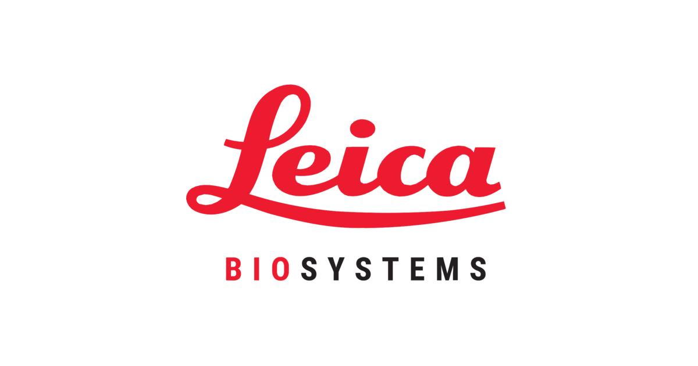

  

<table>
  <tr>
    <td width="28%" align="center">
      
    </td>
    <td width="72%" valign="middle">
      
<strong>SOFTWARE ENGINEER · LEICA BIOSYSTEMS</strong>

      <h1>Jacob Bananal</h1>
      
I build thoughtful software across desktop, backend, and web—favoring clear design, dependable systems, and tools that make work better.

    </td>
  </tr>
</table>

---

<table>
  <tr>
    <td width="62%" valign="top">
      <h2>About</h2>
      
I’m a software engineer at <strong>Leica Biosystems</strong>. I enjoy turning complex requirements into maintainable applications, practical APIs, and reliable data workflows.

      
<strong>Areas I enjoy:</strong>

      <ul>
        <li>Modern .NET and desktop application development</li>
        <li>Backend services, API design, and relational data</li>
        <li>Linux systems, shell tools, and developer workflows</li>
      </ul>
      
<strong>Current environment:</strong> Ubuntu 24.04.5 LTS · systemd · SSH · Shell · YSH

    </td>
    <td width="38%" align="center" valign="middle">
      
       
      Code, coffee, repeat.
    </td>
  </tr>
</table>

## Toolbox

| Languages | Application & Web | Data | Systems & Tools |
| --- | --- | --- | --- |
| `C#` `Go` `SQL` `TypeScript` `Python` `C++` `VB.NET` | `.NET` `ASP.NET Core` `WPF` `WinForms` `React` `Redux` `HTMX` | `SQL Server` `PostgreSQL` `MySQL` `SQLite3` | `Linux` `Ubuntu` `systemd` `SSH` `Shell` `YSH` `Git` `Docker` `IIS` |

## Selected Builds

<table>
  <tr>
    <td width="33%" valign="top">
      
<strong>API · .NET</strong>

      <h3><a href="https://github.com/JacobBananalDev/greenbook">GreenBook</a></h3>
      
A layered .NET API showcasing clean architecture, JWT authentication, and containerized deployment.

      .NET 8 · PostgreSQL · Docker
    </td>
    <td width="33%" valign="top">
      
<strong>DATA · PYTHON</strong>

      <h3><a href="https://github.com/JacobBananalDev/octagoniq">OctagonIQ</a></h3>
      
An MMA analytics backend built around testing, containerization, and scalable API design.

      FastAPI · PostgreSQL · Pytest
    </td>
    <td width="33%" valign="top">
      
<strong>WEB · REACT</strong>

      <h3><a href="https://github.com/JacobBananalDev/QuikNote">QuikNote</a></h3>
      
A note-taking app organized around modular React architecture and clean UI patterns.

      React · TypeScript · Tailwind
    </td>
  </tr>
</table>

## Find Me

**Building reliable things, one thoughtful iteration at a time.**

[Portfolio](https://jacobbananal-dev.vercel.app) ·
[LinkedIn](https://www.linkedin.com/in/jacob-bananal-76a418217/) ·
[Email](mailto:bananal.r.jacob@gmail.com) ·
[LeetCode](https://leetcode.com/JacobBananal/)

